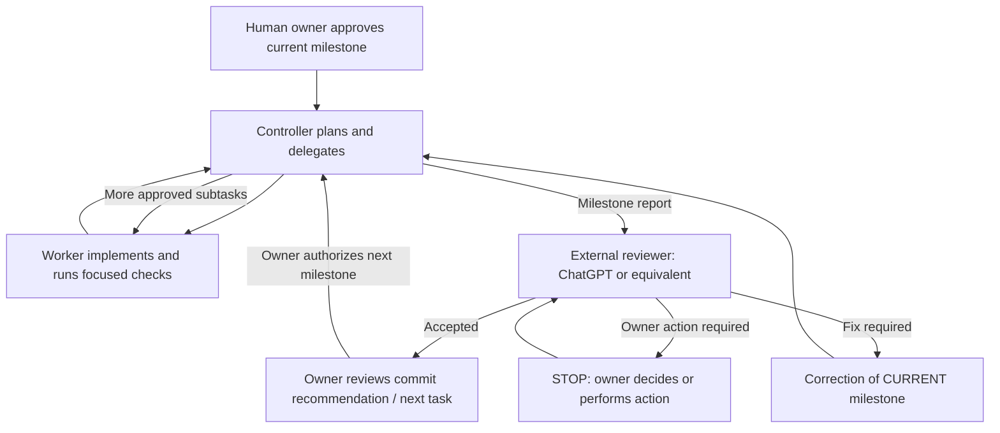

# justprepy AI Workflow

**A reusable, human-controlled workflow for AI-assisted software development.**

This repository contains two complementary instruction sets:

1. **Team orchestration:** a Controller delegates bounded implementation tasks to a real Worker, verifies the results, handles blockers, and reports back.
2. **External review:** ChatGPT (or another review assistant) evaluates that report, decides whether the current milestone is accepted, and determines whether to issue a correction, request an owner decision, or propose the next task.

The workflow was developed for **justprepy**, but the core rules work with other repositories, languages, and AI coding tools. **Antigravity and ChatGPT are examples, not dependencies.**

> **Human approval is the final gate.** No skill file grants permission to change database schemas, execute remote operations, deploy, or commit on the owner's behalf.

## What's in this repository?

```text
.
├── README.md
├── justprepy-teamwork/
│   └── SKILL.md
└── justprepy-chatgpt-review/
    ├── SKILL.md
    ├── CHATGPT_PROJECT_INSTRUCTIONS.md
    └── references/
        └── justprepy-policy.md
```

| File | Purpose | Who uses it? |
| --- | --- | --- |
| [`justprepy-teamwork/SKILL.md`](justprepy-teamwork/SKILL.md) | Delegation, dependency grouping, hard stops, bounded retries, verification, concise Worker handoffs | **Controller** and **Worker** in a coding-agent environment |
| [`justprepy-chatgpt-review/CHATGPT_PROJECT_INSTRUCTIONS.md`](justprepy-chatgpt-review/CHATGPT_PROJECT_INSTRUCTIONS.md) | Short, ready-to-paste review instructions | **ChatGPT Project** or equivalent reviewer instructions |
| [`justprepy-chatgpt-review/SKILL.md`](justprepy-chatgpt-review/SKILL.md) | Detailed review decision tree, evidence standards, commit gate, and next-task policy | **External reviewer**; reference/attachment where supported |
| [`justprepy-chatgpt-review/references/justprepy-policy.md`](justprepy-chatgpt-review/references/justprepy-policy.md) | justprepy-specific routes, naming, stage history, Auth, DB approval gates | **Only the justprepy project** |

The `SKILL.md` files are portable *instructions*, not executables or integrations. Whether your agent platform discovers them automatically depends on that platform's configuration.

## The two-layer workflow



**Controller ≠ external reviewer.** The Controller checks the Worker's outputs *within the approved milestone*. The external reviewer evaluates the **milestone as a whole** and can withhold the next prompt. The owner can override neither safety constraints nor real system permissions simply by naming a skill.

### Layer A — Controller + Worker

The Controller:

- Reads the active task, repository rules, and Git state once; plans only the minimum useful task dependencies.
- Delegates only the next ready group to a **real Worker**, with a goal, allowed files, acceptance criteria, and stop conditions.
- Reviews changed files, diffs, observed checks, and blocker reports before delegating more work.
- Allows independent work past a *soft* blocker only if no prerequisite or acceptance condition is compromised.
- Stops on hard blockers (owner decisions, unauthorized scope, security concerns, remote/production changes).
- Produces one concise, evidence-based milestone report and **stops**. It does not self-authorize a new milestone.

The Worker:

- Changes only authorized files, performs focused verification, and reports `completed`, `blocked`, or `failed` with evidence.
- Does not claim an unrun test passed, silently widen scope, commit, push, or deploy.
- For deferrable issues, provides `confidence` (`high` / `medium` / `low`) **and a specific retry condition**. Confidence never overrides an approval gate.

For an atomic change, the Controller should delegate **one task**, not invent extra subtasks. Group-level checks should be focused; full regression checks belong at the appropriate milestone boundary.

### Layer B — ChatGPT / external review

For every Controller report, apply this **strict decision order**:

| Priority | Condition | Reviewer response |
| --- | --- | --- |
| **1 — Owner action** | Human approval, environment setup, browser check, field/schema decision, remote DB operation, etc. | **STOP.** Explain what the owner must do. **Do not generate an AI implementation prompt.** Re-evaluate after the owner responds. |
| **2 — Error/incomplete** | Failed mandatory check, security defect, out-of-scope change, unresolved acceptance criterion | **Stay on the current milestone.** Explain the issue and, if no owner action is needed, provide one narrow correction prompt. |
| **3 — Accepted** | Required outcome and checks are satisfied, with no blocking decision | Recommend the next **single approved** milestone, using one concise Controller-facing prompt. |

Every report review ends with **`Можно ли коммитить? — ДА / НЕТ`** (or an equivalent clear yes/no in your chosen language), plus **one exact commit message if yes**. Only the human owner executes the commit. If there are no changes, say that no commit is required.

The Controller's `completed` label is **not independent verification**. Distinguish what the agent reported from what the owner or reviewer actually observed. For example, SQL text checks are not live PostgreSQL RLS tests, and local verification is not a remote deployment.

## Quick start: Antigravity Teamwork + ChatGPT

### 1. Install the coding-team skill

Make the full `justprepy-teamwork` folder available in the **skills location recognized by your Antigravity installation** (project-scoped or user-scoped). Keep the filename exactly `SKILL.md` and preserve its YAML front matter.

If your installation supports named skill invocation, explicitly activate **`justprepy-teamwork`** when assigning a substantial task. The syntax and skill search locations may vary by Antigravity version: confirm them in your own installation rather than assuming a specific slash-command path.

**Important:** the skill requests **one Controller and one real Worker**. Some Teamwork runtimes may instantiate additional mandatory agents; the skill cannot enforce a physical agent count. If exactly two real agents are required, verify that the runtime actually supports it. Never simulate a second agent's results.

### 2. Configure the external reviewer

In ChatGPT, open the **Project** you use for the repository and paste the contents of [`CHATGPT_PROJECT_INSTRUCTIONS.md`](justprepy-chatgpt-review/CHATGPT_PROJECT_INSTRUCTIONS.md) into that Project's instructions.

Optionally add [`justprepy-chatgpt-review/SKILL.md`](justprepy-chatgpt-review/SKILL.md) and the applicable project-policy reference to the Project as reference files. **Uploading a skill file does not automatically install it as a native ChatGPT skill.** The Project Instructions are the direct, reliable way to apply the review rules in that Project.

For **justprepy**, keep the `references/justprepy-policy.md` overlay. For another project, replace it with your own policy (see below).

### 3. Assign one milestone to the Controller

Use a short task-specific prompt; do **not** repeat the entire skills in every message:

```text
Use the justprepy-teamwork process with real Controller/Worker delegation.

STAGE: R10a (example; keep this project's existing stage IDs)
GOAL: <one measurable result>
SCOPE: <specific files/operations authorized>
STOP IF: <owner approval, unexpected dependency, failed safety gate>
ACCEPTANCE: <checks that demonstrate completion>

No unrelated changes, commits, pushes, or deployments.
Return one Controller milestone report, then STOP.
```

> `R10a` is illustrative **only**. Other projects should retain their existing naming scheme rather than adopting justprepy's R-series.

### 4. Review the result before continuing

Paste the **Controller's final report** (plus relevant diff, test results, and any manual browser/DB findings) into the ChatGPT Project. The reviewer follows the three gates above:

- **Accepted:** gives a commit recommendation and, when already authorized, the next small Controller prompt.
- **Correction needed:** gives only the current-stage correction, **not** the next milestone.
- **Owner action needed:** gives **no agent prompt**; tells the owner what to check/approve first.

After the owner completes an action, share the result with the reviewer. The reviewer re-evaluates the same milestone before deciding to proceed.

## Using other platforms (not Antigravity or ChatGPT)

These are **roles and contracts**, not proprietary tool calls. Map them to whatever your tools provide:

| Workflow role | Possible replacement | Required adaptation |
| --- | --- | --- |
| **Controller** | A lead agent in a multi-agent IDE, coding CLI, custom orchestration service, or agent framework | Give it the teamwork skill as instructions; wire up real delegation and enforce the handoff format. |
| **Worker** | A delegated coding subagent, isolated CLI session, or automation job | Restrict its file/operation scope; return real diffs and test outputs to Controller. |
| **External reviewer** | Claude, Gemini, Codex, another ChatGPT workspace, a human reviewer, or a custom evaluation agent | Put the review instructions in that system's actual **project/system/custom-instructions** mechanism. Preserve the decision gates and owner-only approvals. |
| **Human owner** | Maintainer or team approver | Explicitly approve restricted decisions; manually control commits and deployments. |

**If your tool has no real agent delegation:** do not claim a two-agent Teamwork run. Either use an actual separate Worker session with an explicit handoff and returned evidence, or adapt the teamwork skill into a **single-agent execution checklist** and label it honestly. Single-agent use may be cheaper for small tasks, but it is not two-agent orchestration.

**If your tool has no skills feature:** place the relevant Markdown content in repository-level agent instructions or custom instructions, and explicitly reference it in task prompts. A normal Markdown file is not automatically enforced simply because it exists in a repo.

**If your reviewer is not ChatGPT:** `CHATGPT_PROJECT_INSTRUCTIONS.md` is a convenient template, not a mandatory filename or feature. Copy its logic into the receiving tool's supported instruction system. Rename any ChatGPT/Antigravity-specific references to actual roles and verify the tool can perform the requested checks; never invent tool access.

**If the coding agents and reviewer share one workspace:** keep the separation of duties conceptually, but explicitly manage file ownership, Git branches/worktrees, ports, build caches, and evidence provenance. A review assistant must not silently start implementing or approve its own unverified claims.

## Adapting to a different repository

Before using these instructions outside justprepy, customize the following:

| Item to adapt | What to substitute |
| --- | --- |
| Project name and paths | Product spelling, repo rules, architecture, directories, and canonical routes |
| Milestone numbering | Existing tickets, issues, stages, or release IDs (do not invent a new series) |
| Approval gates | Your owner/security/data-privacy policies, including DB fields, production access, billing, credentials, and deployment |
| Allowed changes | File allowlists, database environments, third-party integrations, and parallel contributors |
| Verification | Appropriate unit/integration tests, typechecker, build, smoke tests, database tests, or browser checks |
| Agent runtime | Actual delegation API, number of agents, instruction installation method, and isolation capabilities |
| Reviewer runtime | How project/custom instructions are applied; whether reports/diffs can be independently inspected |
| Commit policy | Human approver, branching conventions, and message format |

**Remove or replace** the justprepy-only reference policy rather than carrying over its `/app` routing, Supabase details, OAuth history, or R-series stage IDs. The two main skill files are intentionally project-agnostic despite their names; you may rename the skill directories and YAML `name` values to suit your organization.

### Project-specific overlay example

For a different project, provide a short separate policy file or repository instruction:

```text
Project: <name>
Protected areas: <auth, payments, production DB, etc.>
Owner-only decisions: <schema fields, deploys, secrets, destructive actions>
Approved routes/contracts: <if relevant>
Required tests: <commands or criteria>
Parallel work ownership: <files, branches, servers>
Stage convention: <existing convention>
```

This overlay **adds** repository-specific constraints; it does not supersede higher-priority system rules or grant permissions.

## Hard stops and deferred work

Never quietly continue past a hard stop. Typical hard stops include missing owner approval for database fields, destructive or remote changes, security failures, unauthorized files, or conflicts with concurrent work.

A **soft blocker** can be deferred only if it does not invalidate dependent tasks. Record the blocked task, impact, `high` / `medium` / `low` confidence, and a verifiable `retry_condition`. A high-confidence guess is **not** a license to bypass a gate or retry indefinitely.

At the end of the Controller's milestone, use one of these exact statuses:

```text
completed
completed with caveat
initially incomplete, but resolved later
incomplete - no solution
blocked - owner action required
```

## Boundaries and limitations

- This repository provides **instruction templates**, not an executable orchestration engine, automatic ChatGPT↔IDE connection, or enforcement of database access controls.
- Skills **cannot override** a platform's higher-priority instructions, permission model, or actual agent count.
- Full tests are not required after every trivial edit, but mandatory verification must be completed at the appropriate risk/acceptance boundary.
- Do not share access tokens, OAuth codes, database passwords, or private records in agent reports or GitHub issues.
- For tiny one-file tasks, a single coding agent plus external review may be more token-efficient than coordinating multiple agents.

## License

No license is bundled in these workflow files. If publishing this repository for reuse, **choose and add a `LICENSE` file** so contributors know the terms.
